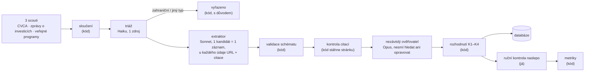

# Spolehlivá databáze investorů — pilot: VC fondy v Česku

Řešení zadání A (Junior AI Developer). Cílem je databáze investorů, ve které je **každý záznam skutečný a aktivní investor** a **každý údaj má zdroj a datum**. Postup je ověřený na vzorku: venture kapitálové fondy s investičním týmem v Česku.

> **Stav k 12. 10. 2026:** plán, schéma, kód s testy a seznam kandidátů jsou hotové. Pilot běží po krocích R1–R8 (runbook v [`CLAUDE.md`](CLAUDE.md)): triáž je hotová z poloviny, extrakce, ověření a moje ruční kontrola následují. Čísla označená *čeká* doplním z [`results/accuracy.md`](results/accuracy.md) po dokončení, nejpozději 16. 10.

## Výsledek v číslech

| | Stav |
|---|---|
| Řádků od tří scoutů → unikátních kandidátů | **300 → 225** ([`cz_vc.csv`](data/candidates/cz_vc.csv)) |
| Triáž (levný první průchod, Haiku) | 125 z 225 hotovo: 58 do plné extrakce, 67 vyřazeno (38 zahraniční tým, 22 jiný typ investora, 7 jiné důvody) |
| Zařazeno do databáze (aktivní VC/CVC s týmem v ČR) | *čeká* |
| Přesnost záznamu na ručně ověřeném vzorku (95% interval) | *čeká* |
| Přesnost jednotlivých údajů / platnost citací | *čeká* |
| Náklad na zařazený záznam (výpočet + ruční kontrola) | *čeká*; zatím spotřebováno 2,3 mil. tokenů (scouti a dva pokusy o triáž) |

Podrobně: plán [`PLAN.md`](PLAN.md) · měření [`results/accuracy.md`](results/accuracy.md) · databáze [`data/records/cz_vc.csv`](data/records/cz_vc.csv) · rozhodnutí o každém kandidátovi [`data/candidates/cz_vc_decisions.csv`](data/candidates/cz_vc_decisions.csv)

## Jak to funguje



Tři zásady:

1. **Agenti sbírají fakta, rozhoduje kód.** O zařazení rozhoduje [`src/decide.py`](src/decide.py) podle pravidel z plánu, takže výsledek jde zopakovat a otestovat ([`tests/test_decide.py`](tests/test_decide.py)).
2. **Nepodložený údaj se vynuluje, neopravuje.** Pokud ověřovatel řekne „nepodložené“ nebo skript nenajde citaci na stránce, údaj zmizí. Záznam bez doložené investice za posledních 24 měsíců do databáze nepatří.
3. **Kontroly jsou na sobě nezávislé.** Skript kontroluje text stránky, ověřovatel kontroluje význam a já kontroluji naslepo bez znalosti jejich verdiktů. Díky tomu jde změřit i to, jak dobře funguje samotný ověřovatel.

## Co je v repozitáři

| Cesta | Obsah |
|---|---|
| [`PLAN.md`](PLAN.md) | plán: kdo do databáze patří a kdo ne, zdroje, ověřování, odhad rozsahu světa, náklady |
| [`schema/`](schema/) | schéma záznamu (každý údaj = hodnota + zdroj, nebo `null` + důvod) a smyšlený ukázkový záznam |
| [`.claude/agents/`](.claude/agents/) | pokyny pro čtyři agenty; vývoj pokynů je v commitech `agents:` |
| [`src/`](src/), [`tests/`](tests/) | sloučení kandidátů, validace, kontrola citací, pravidla zařazení, kurzy ECB, list ruční kontroly, metriky (49 testů) |
| [`data/candidates/`](data/candidates/) | výstupy scoutů, sloučený seznam, triáž (včetně neúspěšného prvního pokusu), fronta extrakce, rozhodnutí |
| `data/records/` | záznamy od extraktoru, po rozhodnutí a výsledná databáze (`cz_vc.jsonl`, `cz_vc.csv`) |
| `data/quote_checks/`, `data/verification/` | výsledek kontroly citací a verdikty ověřovatele ke každému záznamu |
| `data/manual_review/` | list ruční kontroly (`review.html`) a moje hodnocení |
| [`data/runs/run_log.csv`](data/runs/run_log.csv) | tokeny, počet nástrojů a čas každého běhu agenta |
| [`docs/decisions.md`](docs/decisions.md), [`docs/ai-errors.md`](docs/ai-errors.md) | rozhodnutí v nejasných bodech a chyby AI |
| [`ai-log/`](ai-log/) | exporty konverzací s AI |

## Jak spustit

```bash
python3 -m venv .venv && .venv/bin/python -m pip install -r requirements.txt
.venv/bin/python -m pytest -q                 # testy
.venv/bin/python -m src.fx --update           # kurzy ECB
.venv/bin/python -m src.decide --triage       # fronta extrakce z triáže
.venv/bin/python -m src.validate              # validace záznamů od extraktoru
.venv/bin/python -m src.check_quotes          # stáhne citované stránky a hledá citace
.venv/bin/python -m src.decide                # rozhodnutí o všech kandidátech -> databáze
.venv/bin/python -m src.review_sheet          # list ruční kontroly -> data/manual_review/review.html
.venv/bin/python -m src.metrics               # přesnost a náklady -> results/accuracy.md
```

Kroky s agenty (triáž, extrakce, ověření) spouští Claude Code podle runbooku v [`CLAUDE.md`](CLAUDE.md). Každý krok jde přerušit a obnovit, protože přeskočí hotovou práci.

## Jak jsem pracoval s AI

### Rozdělení práce

| Kdo | Co |
|---|---|
| **Claude v aplikaci Claude** (agentní režim, `claude-opus-5-5`) | rešerše a návrh plánu, schéma, pokyny pro agenty, většina kódu a testů, spuštění scoutů a prvního pokusu o triáž, tento README. Konverzace je v [`ai-log/00`](ai-log/00-claude-app-plan-build-orchestrace.md). |
| **Claude Code na mém počítači** | první krok kódu (`config.py`, `validate.py`, testy) a běh pilotu podle runbooku: triáž, extrakce, kontrola citací, ověření, rozhodnutí. |
| **Já** | výběr zadání, schválení plánu a pravidel, spouštění a schvalování kroků, rozhodnutí o přesunu agentů na můj počítač, ruční kontrola vzorku (ground truth). |

### Jaké pokyny dostali agenti

Pokyny jsou v [`.claude/agents/`](.claude/agents/). Jak se vyvíjely, ukazuje `git log -- .claude/agents/`.

| Agent | Model | Úkol | Klíčové pokyny | Proč takhle |
|---|---|---|---|---|
| [`candidate-scout`](.claude/agents/candidate-scout.md) | Sonnet | kandidáti z jednoho zdroje | priorita úplnost; nehádat domény; nerozhoduje o zařazení | chybějící kandidát je ztracený navždy, nadbytečný stojí jen jeden běh extraktoru |
| [`candidate-triage`](.claude/agents/candidate-triage.md) | Haiku | sídlo týmu + typ investora, 1 zdroj | 1–3 vyhledávání na kandidáta, `unknown` místo odhadu | levný filtr před drahou extrakcí (krok „triáž“ z nákladového modelu v PLAN §8) |
| [`investor-extractor`](.claude/agents/investor-extractor.md) | Sonnet | jeden kandidát → jeden záznam | u každého údaje URL, datum a doslovná citace ≤ 25 slov; ticket ≠ velikost kola; kapitál nikdy nesčítá; nic nedopočítává; sám si spustí validaci | „chybný údaj je horší než chybějící“; model má sklon dopočítávat tickety a kapitál |
| [`evidence-verifier`](.claude/agents/evidence-verifier.md) | Opus | audit jednoho záznamu | nový kontext, nevidí úvahy extraktoru, **nesmí vyhledávat ani opravovat**, jen posoudí, zda zdroj tvrzení podporuje | model, který kontroluje vlastní výstup, ho má sklon potvrdit; ověřovatel, který smí hledat, se stane druhým extraktorem |

### Jak jsem kontroloval jejich výstup

1. **Schéma** ([`src/validate.py`](src/validate.py)) odmítne údaj bez zdroje, `null` bez důvodu, neexistující datum, citaci delší než 25 slov i agenta, který si sám nastaví stav záznamu.
2. **Kontrola citací** ([`src/check_quotes.py`](src/check_quotes.py)) stáhne každou citovanou stránku a hledá citaci fuzzy shodou. Nástroj WebFetch totiž agentovi nevrací stránku, ale shrnutí malého modelu, takže „doslovná“ citace může být parafráze.
3. **Nezávislý ověřovatel** dává verdikt ke každému údaji: podloženo / částečně / nepodloženo / v rozporu / neověřitelné.
4. **Pravidla v kódu** ([`src/decide.py`](src/decide.py)) z verdiktů vyvodí, co zůstane, a rozhodnou o zařazení. Každé pravidlo i hraniční případ z plánu má test.
5. **Zkušební dávka:** orchestrátor po prvních čtyřech záznamech přečte výstup proti zdrojům; systematickou chybu opraví v pokynech a dávku spustí znovu.
6. **Ruční kontrola naslepo** ([`src/review_sheet.py`](src/review_sheet.py)): kontroluji hodnoty od extraktoru bez znalosti verdiktů ověřovatele a skriptu. Jedna kontrola tak změří extraktor, ověřovatele i finální databázi.

### Kde se AI mýlila

Úplný seznam je v [`docs/ai-errors.md`](docs/ai-errors.md). Zatím:

- **Scout doplnil sídlo zahraničních fondů z vlastní znalosti**, ne ze zdroje (E-01). Sám to přiznal ve zprávě. Sídlo se proto bere jen jako nápověda a znovu ho zjišťuje triáž.
- **Agenti považovali výstup WebFetch za text stránky** (E-02), i když je to shrnutí jiného modelu. Proto každou citaci kontroluje skript proti skutečné stránce.
- **První pokus o triáž skončil u 80 % kandidátů výsledkem `unknown`** (E-03). Nešlo o chybu modelu, ale o prostředí: agenti v cloudu sdíleli jeden limit vyhledávání a každé stažení stránky mimo výsledky vyhledávání čekalo na moje schválení. Běh agentů jsem proto přesunul do Claude Code na svůj počítač (D-010). Neúspěšný pokus zůstává v `data/candidates/triage/attempt1/`.
- **Haiku je při triáži nekonzistentní** (E-06): u zjevně amerických fondů (Accel, Battery Ventures) nechal sídlo `unknown` a opakovaný běh téže dávky dal jiné odpovědi. `unknown` proto nikoho nevyřazuje, kandidát jde do plné extrakce. Chyba tak zvyšuje náklad, ale nezpůsobí ztrátu kandidáta.
- **Dvakrát se objevil prompt injection** (E-04, E-07): titulek ve výsledcích vyhledávání a text na webu jednoho fondu obsahovaly pokyny pro jazykový model. Agenti je rozpoznali a ignorovali.
- *Chyby extraktoru a ověřovatele z pilotu a z ruční kontroly doplním po dokončení.*

## Rozhodnutí v nejasných bodech zadání

Podrobně v [`docs/decisions.md`](docs/decisions.md); nejdůležitější:

| Otázka | Rozhodnutí | Proč |
|---|---|---|
| Co je jeden záznam? | správce / značka, fondy pod ním (D-001) | tým, teze a kontakt patří správci, fondy se překrývají |
| Kdy je investor „aktivní“? | doložená investice za 24 měsíců, nebo nový fond do 12 měsíců; 24–36 měsíců = `dormant` (D-002) | menší CEE fondy dělají jen jednotky investic ročně |
| Kde investor „sídlí“? | tam, kde sedí investiční tým, ne kde je registrovaný fond (D-003) | český tým s lucemburským fondem je český investor |
| Co je „celkový investiční kapitál“? | číslo + základ (`reported_aum` / součet fondů / poslední fond) + datum (D-004) | zdroje míchají AUM a velikost posledního fondu |
| Přesnost, nebo úplnost? | přesnost (D-005) | špatně zařazený subjekt poškodí důvěru víc než chybějící |
| Rozsah pilotu | VC + CVC s týmem v ČR, bez andělů (D-006) | zadání navrhuje VC v jedné zemi; andělé jsou fyzické osoby (GDPR) |
| Datum sběru | pevně 11. 10. 2026 (D-007) | všechna okna se počítají od jednoho data |
| 225 kandidátů je moc na plnou extrakci | levná triáž předem, její chybovost měřím na vzorku (D-009) | odpovídá nákladovému modelu pro celý svět |
| Proč exkluzní signály ve schématu | agent zapíše doložený fakt („jen dluh“), kód rozhodne (D-011) | i důvod vyřazení potřebuje zdroj |
| Rozsah ruční kontroly | všechny zařazené (max. 40), všechna vyřazení z pipeline, 15 náhodných vyřazení z triáže (D-012) | 100 % z 225 kandidátů by bylo hlavně kontrolování zahraničních fondů |

## Co v řešení chybí

- **Výsledky pilotu a změřená přesnost** zatím chybí (viz stav nahoře).
- **PE, family office a andělé** nejsou v pilotu změřeni. Plán pro ně platí, jejich přesnost ale není ověřená.
- **Kontrola citací nepřečte stránky vykreslované JavaScriptem ani skeny.** Takové citace označí jako `unreachable` a rozhoduje ověřovatel.
- **Náklad v USD je odhad.** Claude Code hlásí jen celkový počet tokenů bez rozdělení na vstup a výstup; počítám s poměrem 90 : 10 ([`src/metrics.py`](src/metrics.py)).
- **Triáž není deterministická** (E-06). Pro produkční běh by stálo za to triáž zdvojit, nebo `unknown` posílat rovnou do extrakce (to už se děje).

## Náklady na rozšíření na celý svět

Odhad z plánu ([PLAN §8](PLAN.md#8-náklady-na-rozšíření-na-celý-svět)): **řádově 35–50 tis. EUR za první běh** pro ~16–25 tis. ověřitelných investorů (výpočet 12–23 tis. USD, ruční kontrola ~15 tis. EUR, vývoj 8–12 tis. EUR) a ~10 tis. EUR za každou pololetní obnovu.

*Po pilotu přepočítám vzorec z naměřených hodnot:* tokeny na kandidáta v triáži, extrakci a ověření, poměr kandidátů a zařazených záznamů a minuty ruční kontroly na záznam. Zatím naměřeno: triáž stojí ~60–86 tis. tokenů na dávku 25 kandidátů, tedy ~3 tis. tokenů na kandidáta.
