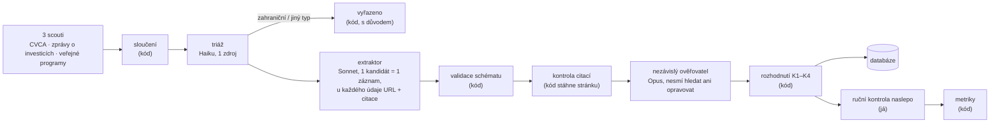

# Spolehlivá databáze investorů — pilot: VC fondy v Česku

Cílem je databáze investorů, ve které je **každý záznam skutečný a aktivní investor** a **každý údaj má zdroj a datum**. Postup je ověřený na vzorku: venture kapitálové fondy s investičním týmem v Česku.

## Výsledek v číslech

| | |
|---|---|
| Kandidáti (3 scouti, po sloučení) | **224** |
| Plně zpracováno (extrakce + ověření) | 69 (fronta 70 nejsilnějších českých kandidátů, D-016) |
| **Zařazeno do databáze** (aktivní VC/CVC s týmem v ČR) | **34** ([`cz_vc.csv`](data/records/cz_vc.csv)) |
| **Přesnost záznamu** (ručně ověřený náhodný vzorek 12) | **75 %** (9/12; 95% CI 47–91 %); dalších 2/12 částečně správně |
| Přesnost údajů ve finální databázi (ticket, kapitál, nejnovější investice) | **90 %** (18/20; 95% CI 70–97 %) |
| Správnost vyřazení: pipeline / triáž | 90 % (9/10) / 100 % (5/5) |
| Platnost citací (citace skutečně na stránce, kontrola skriptem) | **97,9 %** (424/433) |
| Náklad na zařazený záznam | **0,53 USD** výpočtu (7,0 mil. tokenů celkem, odhad 18 USD) + 0,8 min ruční kontroly |

Vzorek ruční kontroly je malý (48 řádků, D-020), proto jsou intervaly spolehlivosti široké: výsledek ukazuje, že pipeline funguje a kde chybuje, ne přesné procento.

Podrobně: plán [`PLAN.md`](PLAN.md) · měření [`results/accuracy.md`](results/accuracy.md) · databáze [`data/records/cz_vc.csv`](data/records/cz_vc.csv) · rozhodnutí o každém kandidátovi [`data/candidates/cz_vc_decisions.csv`](data/candidates/cz_vc_decisions.csv)

## Jak to funguje



Tři zásady:

1. **Agenti sbírají fakta, rozhoduje kód.** O zařazení rozhoduje [`src/decide.py`](src/decide.py) podle pravidel z plánu, takže výsledek jde zopakovat a otestovat ([`tests/test_decide.py`](tests/test_decide.py)).
2. **Nepodložený údaj se vynuluje, neopravuje.** Pokud ověřovatel řekne „nepodložené“ nebo skript nenajde citaci na stránce, údaj zmizí. Záznam bez doložené investice za posledních 24 měsíců do databáze nepatří.
3. **Kontroly jsou na sobě nezávislé.** Skript kontroluje text stránky, ověřovatel kontroluje význam a já kontroluji naslepo bez znalosti jejich verdiktů. Díky tomu jde změřit i to, jak dobře funguje samotný ověřovatel.

## Co je v repozitáři

| Cesta | Obsah |
|---|---|
| [`PLAN.md`](PLAN.md) | plán: kdo do databáze patří a kdo ne, zdroje, ověřování, odhad rozsahu světa, náklady |
| [`schema/`](schema/) | schéma záznamu (každý údaj = hodnota + zdroj, nebo `null` + důvod) a smyšlený ukázkový záznam |
| [`.claude/agents/`](.claude/agents/) | pokyny pro čtyři agenty; vývoj pokynů je v commitech `agents:` |
| [`src/`](src/), [`tests/`](tests/) | sloučení kandidátů, validace, kontrola citací, pravidla zařazení, kurzy ECB, list ruční kontroly, metriky, testy pravidel |
| [`data/candidates/`](data/candidates/) | výstupy scoutů, sloučený seznam, triáž (včetně neúspěšného prvního pokusu), fronta extrakce, rozhodnutí |
| `data/records/` | záznamy od extraktoru, po rozhodnutí a výsledná databáze (`cz_vc.jsonl`, `cz_vc.csv`) |
| `data/quote_checks/`, `data/verification/` | výsledek kontroly citací a verdikty ověřovatele ke každému záznamu |
| `data/manual_review/` | list ruční kontroly (`review.html`) a moje hodnocení |
| [`data/runs/run_log.csv`](data/runs/run_log.csv) | tokeny, počet nástrojů a čas každého běhu agenta |
| [`docs/decisions.md`](docs/decisions.md), [`docs/ai-errors.md`](docs/ai-errors.md) | rozhodnutí v nejasných bodech a chyby AI |
| [`ai-log/`](ai-log/) | exporty konverzací s AI |

## Jak spustit

```bash
python3 -m venv .venv && .venv/bin/python -m pip install -r requirements.txt
.venv/bin/python -m pytest -q                 # testy
.venv/bin/python -m src.fx --update           # kurzy ECB
.venv/bin/python -m src.decide --triage       # fronta extrakce z triáže
.venv/bin/python -m src.validate              # validace záznamů od extraktoru
.venv/bin/python -m src.check_quotes          # stáhne citované stránky a hledá citace
.venv/bin/python -m src.decide                # rozhodnutí o všech kandidátech -> databáze
.venv/bin/python -m src.review_sheet          # list ruční kontroly -> data/manual_review/review.html
.venv/bin/python -m src.metrics               # přesnost a náklady -> results/accuracy.md
```

Kroky s agenty (triáž, extrakce, ověření) spouští Claude Code podle runbooku v [`CLAUDE.md`](CLAUDE.md). Každý krok jde přerušit a obnovit, protože přeskočí hotovou práci.

## Jak jsem pracoval s AI

### Rozdělení práce

| Kdo | Co |
|---|---|
| **Claude v aplikaci Claude** (agentní režim, `claude-opus-5-5`) | rešerše a návrh plánu, schéma, pokyny pro agenty, většina kódu a testů, spuštění scoutů a prvního pokusu o triáž, tento README. Konverzace je v [`ai-log/00`](ai-log/00-claude-app-plan-build-orchestrace.md). |
| **Claude Code na mém počítači** | první krok kódu (`config.py`, `validate.py`, testy) a běh pilotu podle runbooku: triáž, extrakce, kontrola citací, ověření, rozhodnutí, opravný průchod. Jako orchestrátor sám našel a zalogoval většinu chyb E-06 až E-21 a dvakrát upravil pravidla nebo prompt. Log: [`ai-log/01`](ai-log/01-pilot-r0-r8.md). |
| **Já** | výběr zadání, schválení plánu a pravidel, spouštění a schvalování kroků, rozhodnutí o přesunu agentů na můj počítač, zkrácená ruční kontrola náhodného vzorku (48 řádků, 10 minut), která je jediným „ground truth“ v měření. |

### Jaké pokyny dostali agenti

Pokyny jsou v [`.claude/agents/`](.claude/agents/). Jak se vyvíjely, ukazuje `git log -- .claude/agents/`.

| Agent | Model | Úkol | Klíčové pokyny | Proč takhle |
|---|---|---|---|---|
| [`candidate-scout`](.claude/agents/candidate-scout.md) | Sonnet | kandidáti z jednoho zdroje | priorita úplnost; nehádat domény; nerozhoduje o zařazení | chybějící kandidát je ztracený navždy, nadbytečný stojí jen jeden běh extraktoru |
| [`candidate-triage`](.claude/agents/candidate-triage.md) | Haiku | sídlo týmu + typ investora, 1 zdroj | 1–3 vyhledávání na kandidáta, `unknown` místo odhadu | levný filtr před drahou extrakcí (krok „triáž“ z nákladového modelu v PLAN §8) |
| [`investor-extractor`](.claude/agents/investor-extractor.md) | Sonnet | jeden kandidát → jeden záznam | u každého údaje URL, datum a doslovná citace ≤ 25 slov; ticket ≠ velikost kola; kapitál nikdy nesčítá; nic nedopočítává; sám si spustí validaci | „chybný údaj je horší než chybějící“; model má sklon dopočítávat tickety a kapitál |
| [`evidence-verifier`](.claude/agents/evidence-verifier.md) | Opus | audit jednoho záznamu | nový kontext, nevidí úvahy extraktoru, **nesmí vyhledávat ani opravovat**, jen posoudí, zda zdroj tvrzení podporuje | model, který kontroluje vlastní výstup, ho má sklon potvrdit; ověřovatel, který smí hledat, se stane druhým extraktorem |

### Jak jsem kontroloval jejich výstup

1. **Schéma** ([`src/validate.py`](src/validate.py)) odmítne údaj bez zdroje, `null` bez důvodu, neexistující datum, citaci delší než 25 slov i agenta, který si sám nastaví stav záznamu.
2. **Kontrola citací** ([`src/check_quotes.py`](src/check_quotes.py)) stáhne každou citovanou stránku a hledá citaci fuzzy shodou. Nástroj WebFetch totiž agentovi nevrací stránku, ale shrnutí malého modelu, takže „doslovná“ citace může být parafráze.
3. **Nezávislý ověřovatel** dává verdikt ke každému údaji: podloženo / částečně / nepodloženo / v rozporu / neověřitelné.
4. **Pravidla v kódu** ([`src/decide.py`](src/decide.py)) z verdiktů vyvodí, co zůstane, a rozhodnou o zařazení. Každé pravidlo i hraniční případ z plánu má test.
5. **Zkušební dávka:** orchestrátor po prvních čtyřech záznamech přečte výstup proti zdrojům; systematickou chybu opraví v pokynech a dávku spustí znovu.
6. **Ruční kontrola naslepo** ([`src/review_sheet.py`](src/review_sheet.py)): kontroluji hodnoty od extraktoru bez znalosti verdiktů ověřovatele a skriptu. Jedna kontrola tak změří extraktor, ověřovatele i finální databázi.

### Kde se AI mýlila

Úplný seznam (21 položek) je v [`docs/ai-errors.md`](docs/ai-errors.md). Nejdůležitější:

- **Scout doplnil sídlo zahraničních fondů z vlastní znalosti**, ne ze zdroje (E-01). Sám to přiznal ve zprávě. Sídlo se proto bere jen jako nápověda a znovu ho zjišťuje triáž.
- **Agenti považovali výstup WebFetch za text stránky** (E-02), i když je to shrnutí jiného modelu. Proto každou citaci kontroluje skript proti skutečné stránce.
- **První pokus o triáž skončil u 80 % kandidátů výsledkem `unknown`** (E-03). Nešlo o chybu modelu, ale o prostředí: agenti v cloudu sdíleli jeden limit vyhledávání a každé stažení stránky mimo výsledky vyhledávání čekalo na moje schválení. Běh agentů jsem proto přesunul do Claude Code na svůj počítač (D-010). Neúspěšný pokus zůstává v `data/candidates/triage/attempt1/`.
- **Haiku je při triáži nekonzistentní** (E-06): u zjevně amerických fondů (Accel, Battery Ventures) nechal sídlo `unknown` a opakovaný běh téže dávky dal jiné odpovědi. `unknown` proto nikoho nevyřazuje, kandidát jde do plné extrakce. Chyba tak zvyšuje náklad, ale nezpůsobí ztrátu kandidáta.
- **Triáž by vyřadila český VC fond jako „soukromý holding“** (E-08): Springtide Ventures (VC fond skupiny KKCG) dostal od Haiku typ `private_holding`. Orchestrátor v Claude Code prošel všechna česká vyřazení podle typu, chybu našel a pravidlo zpřísnil: triáž smí vyřadit podle typu jen se staženou stránkou a vysokou jistotou, jinak jde kandidát do plné extrakce (D-015).
- **Zkušební dávka extraktoru odhalila tři systematické chyby** (E-09 až E-11): citace čísla bez popisku („€515M“ bez toho, že jde o fond), investice doložené jen nedatovanými příspěvky a neúplné fáze. Orchestrátor opravil prompt dřív, než běžela zbytek fronty (commit `agents:` 1d41cc1).
- **Šest aktivních českých VC (Kaya, DEPO, Nation 1, Zaka, Czech Founders, PurposeTech) pipeline vyřadila**, protože extraktor nezapsal právnickou osobu a pravidlo K1 ji vyžaduje (E-19). Prompt navíc doporučoval rejstříkové zrcadlo, které zakazuje robots.txt (E-18; chyba v zadání, ne v modelu). Opravný průchod (D-019) prompt opravil a 12 záznamů znovu zpracoval: databáze vzrostla z 27 na 34 záznamů. Ruční kontrola tedy měří pipeline po jedné opravné iteraci.
- **Datum článku místo data investice** (E-20): u Braiins, Tachles a Novira extraktor vzal datum rekapitulace nebo zprávy o exitu. Tuto chybu plán předvídal (PLAN §5.3) a ověřovatel ji zachytil.
- **Ověřovatel je mírný v hodnocení „částečně podloženo“** (E-21): 107 z 436 verdiktů je `partially_supported` a `decide.py` je bere jako podložené. Tak prošla investice BTCZ do Taveren, kterou zdroj nedokládá (E-14), a ruční kontrola ji označila jen jako částečně správnou. Pro další běh: `partially_supported` u důkazu aktivity nepočítat.
- **Ruční kontrola našla jeden chybně zařazený záznam** (Chilli Ventures) a dva částečně správné (BTCZ Ventures, United Founders). V hodnotách ticketu, kapitálu a nejnovější investice ověřovatel nepropustil žádný chybný údaj (0×) a nezahodil žádný správný (0×), ale na 20 hodnotách to je slabý důkaz.
- **Agent vystoupil ze své role** (E-16): extraktor sám spustil kontrolu citací nad všemi záznamy, zatímco jiní ještě zapisovali. Výstup byl smazán a krok proběhl znovu ve správném pořadí.
- **Třikrát se objevil prompt injection** (E-04, E-07, E-17): titulek ve vyhledávání a texty na webech dvou fondů obsahovaly skryté pokyny pro AI. Agenti je rozpoznali a ignorovali; hodnoty záznamu DEPO ověřovatel potvrdil ze zdrojů.

## Rozhodnutí v nejasných bodech zadání

Podrobně v [`docs/decisions.md`](docs/decisions.md); nejdůležitější:

| Otázka | Rozhodnutí | Proč |
|---|---|---|
| Co je jeden záznam? | správce / značka, fondy pod ním (D-001) | tým, teze a kontakt patří správci, fondy se překrývají |
| Kdy je investor „aktivní“? | doložená investice za 24 měsíců, nebo nový fond do 12 měsíců; 24–36 měsíců = `dormant` (D-002) | menší CEE fondy dělají jen jednotky investic ročně |
| Kde investor „sídlí“? | tam, kde sedí investiční tým, ne kde je registrovaný fond (D-003) | český tým s lucemburským fondem je český investor |
| Co je „celkový investiční kapitál“? | číslo + základ (`reported_aum` / součet fondů / poslední fond) + datum (D-004) | zdroje míchají AUM a velikost posledního fondu |
| Přesnost, nebo úplnost? | přesnost (D-005) | špatně zařazený subjekt poškodí důvěru víc než chybějící |
| Rozsah pilotu | VC + CVC s týmem v ČR, bez andělů (D-006) | zadání navrhuje VC v jedné zemi; andělé jsou fyzické osoby (GDPR) |
| Datum sběru | pevně 11. 10. 2026 (D-007) | všechna okna se počítají od jednoho data |
| 225 kandidátů je moc na plnou extrakci | levná triáž předem, její chybovost měřím na vzorku (D-009) | odpovídá nákladovému modelu pro celý svět |
| Kdy triáži věřit | zahraniční sídlo vyřazuje vždy; typ jen se staženou stránkou a vysokou jistotou; dávka s víc než třetinou neznámých sídel se jednou opakuje (D-014, D-015) | chybné vyřazení českého kandidáta je ztráta, kterou pilot měří; zbytečná extrakce je jen náklad |
| Proč exkluzní signály ve schématu | agent zapíše doložený fakt („jen dluh“), kód rozhodne (D-011) | i důvod vyřazení potřebuje zdroj |
| Rozsah pilotu po triáži | 70 nejsilnějších českých kandidátů ze 158 ve frontě; pořadí počítá kód (D-016) | čas a limit vyhledávání; zbytek jsou převážně zahraniční fondy a PE |
| Opravný průchod | 12 záznamů s chybějící právnickou osobou nebo sídlem zpracováno znovu s opraveným promptem (D-019) | chyba byla systematická a známá; jinak by v databázi chyběly největší české VC |
| Rozsah ruční kontroly | 12 náhodných zařazených záznamů × 4 klíčová pole + 10 vyřazení z pipeline + 5 z triáže = 48 řádků (D-020, místo plánovaných ~300) | čas; intervaly jsou proto široké a uvádím je |

## Co v řešení chybí

- **Malý ruční vzorek.** 12 záznamů a 20 hodnot stačí na směr, ne na přesné procento (95% interval přesnosti záznamu je 47–91 %). Sektory, fáze, typ a sídlo se ručně nekontrolovaly, jen skriptem a ověřovatelem.
- **88 kandidátů zůstalo nezpracovaných** (`pending` v [`cz_vc_decisions.csv`](data/candidates/cz_vc_decisions.csv)), převážně zahraniční fondy a PE mimo segment, ale i několik českých subjektů (Genesis Capital, Jet Investment, Pale Fire Capital, Bohemia Venture Capital). Databáze tedy není úplný seznam českých VC.
- **Vyplněnost polí:** ticket má 62 % záznamů, kapitál 41 %. Fondy je často nezveřejňují a extraktor má zakázáno je dopočítávat.
- **PE, family office a andělé** nejsou v pilotu změřeni. Plán pro ně platí, jejich přesnost ale není ověřená.
- **Kontrola citací nepřečte stránky vykreslované JavaScriptem ani skeny.** Takové citace označí jako `unreachable` a rozhoduje ověřovatel.
- **Náklad v USD je odhad.** Claude Code hlásí jen celkový počet tokenů bez rozdělení na vstup a výstup; počítám s poměrem 90 : 10 ([`src/metrics.py`](src/metrics.py)).
- **Triáž není deterministická** (E-06). Pro produkční běh by stálo za to triáž zdvojit, nebo `unknown` posílat rovnou do extrakce (to už se děje).
- **Export první krátké relace v Claude Code** (krok 1 kódu) se nedochoval; práce je v commitech `7fff7cb` a `3cf6879`.

## Náklady na rozšíření na celý svět

Plán odhadoval **35–50 tis. EUR za první běh** ([PLAN §8](PLAN.md#8-náklady-na-rozšíření-na-celý-svět)). Pilot dal skutečné vstupy:

| Naměřeno v pilotu | Hodnota |
|---|---|
| triáž (Haiku) | ~4,4 tis. tokenů na kandidáta |
| extrakce (Sonnet) | ~34 tis. tokenů na kandidáta, ≤ 6 vyhledávání |
| ověření (Opus) | ~17,5 tis. tokenů na záznam |
| poměr extrahovaných : zařazených | ~2 : 1 (69 : 34) |
| celkem za pilot | 7,0 mil. tokenů, odhadem 18 USD, tj. 0,53 USD na zařazený záznam |

Přepočet na celý svět se stejnými předpoklady jako v plánu (200 tis. surových kandidátů, 40 tis. do extrakce, ~20 tis. zařazených záznamů), ceník API (PLAN §8) a 90 % vstupních tokenů:

- triáž: 200 tis. × 4,4 tis. tokenů ≈ 0,9 mld. tokenů Haiku ≈ **0,1 tis. USD**
- extrakce: 40 tis. × 34 tis. tokenů ≈ 1,4 mld. tokenů Sonnet ≈ **3,8 tis. USD**, plus 240 tis. vyhledávání ≈ **2,4 tis. USD**
- ověření: 40 tis. × 17,5 tis. tokenů ≈ 0,7 mld. tokenů Opus ≈ **3,9 tis. USD**
- **výpočet celkem ≈ 10 tis. USD, s rezervou 30 % ≈ 13 tis. USD** (plán: 12–23 tis.)
- ruční kontrola: rychlý režim stál 0,8 min na záznam, plná kontrola všech polí odhadem 3–5 min; vzorek 1 500 záznamů + 2 000 označených ≈ 150–250 h ≈ **6–10 tis. EUR** (plán: 15 tis.)
- vývoj (konektory na registry, fronta, monitoring): beze změny **8–12 tis. EUR**

**První běh tedy vychází na ~25–35 tis. EUR, spíš na spodní hranici plánu.** Největší nejistota není cena tokenů, ale limit vyhledávání (v pilotu ~100 vyhledávání za hodinu na relaci): 240 tis. vyhledávání vyžaduje API s vlastním vyhledávacím rozpočtem nebo paralelní relace. Druhá nejistota je kvalita mimo Česko (jiné jazyky a rejstříky), kterou pilot neměří.
